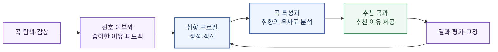
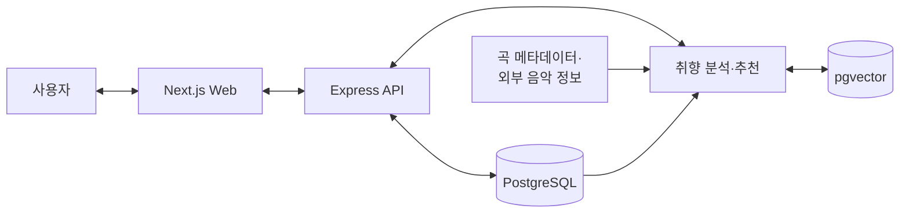

<div align="center">
  <h1>Vocaloid Playlist Web</h1>
  <p>
    <strong>좋아한 노래의 이유를 이해하고, 그 취향을 다음 곡으로 연결하는 Vocaloid 추천 서비스</strong>
  </p>
  <p>
    단순히 같은 곡을 들은 사용자 관계만 따라가지 않습니다.<br />
    사용자가 <strong>어떤 노래를 왜 좋아했는지</strong> 직접 피드백하고,<br />
    그 이유를 음악적 특성과 연결해 비슷한 곡을 설명과 함께 추천합니다.<br />
    완성된 취향 프로필은 링크 하나로 다른 사람과 간편하게 공유할 수 있습니다.
  </p>
</div>

---

## 목차

1. [프로젝트 소개](#1-프로젝트-소개)
2. [추천 방식](#2-추천-방식)
3. [주요 기능](#3-주요-기능)
4. [상세 설계](#4-상세-설계)
5. [개발 방향](#5-개발-방향)
6. [프로젝트 구조](#6-프로젝트-구조)
7. [시작하기](#7-시작하기)
8. [기여하기](#8-기여하기)

---

## 1. 프로젝트 소개

### 1.1 개발 배경

많은 음악 추천 서비스는 청취 이력, 좋아요, 플레이리스트 중복과 같은 **사용자와 콘텐츠의 관계**를 중심으로 추천합니다. 이러한 방식은 대중적인 곡을 발견하는 데 유용하지만 다음과 같은 한계가 있습니다.

- 같은 곡을 좋아하더라도 사용자가 좋아한 **이유**는 서로 다를 수 있습니다.
- 추천 결과가 왜 나왔는지 알기 어려워 사용자가 자신의 취향을 교정하기 어렵습니다.
- 청취 데이터가 적은 신규 사용자와 인지도가 낮은 곡은 충분히 추천받기 어렵습니다.
- 장르, BPM 같은 표면적인 유사성만으로는 Vocaloid 음악의 세밀한 취향을 설명하기 어렵습니다.

Vocaloid 음악에서는 보컬의 조교 방식, 음색, 프로듀서의 작곡 성향, 멜로디와 리듬, 가사의 주제, 분위기, 사운드 디자인 등 다양한 요소가 선호에 영향을 줍니다. 따라서 “이 곡을 들은 사람이 저 곡도 들었다”는 관계뿐 아니라 **사용자가 곡의 어떤 요소에 반응했는지** 이해할 필요가 있습니다.

또한 Vocaloid는 가상 보컬을 활용해 개인 창작자도 비교적 적은 인력으로 곡을 완성하고 공개할 수 있어, 소수의 인기곡 너머에 방대한 창작 생태계가 형성되어 있습니다. 하지만 인지도가 낮은 곡은 청취 관계 데이터가 부족해 기존 추천 시스템에서 발견되기 어렵습니다. 곡 자체의 특성과 명시적인 취향 피드백을 활용하면 이러한 곡도 인기도와 무관하게 적합한 청자에게 연결할 수 있습니다.

### 1.2 프로젝트 목표

Vocaloid Playlist Web은 사용자의 선택과 피드백을 바탕으로 음악적 취향을 구체화하고, 그 취향과 닮은 Vocaloid 곡을 추천하는 웹 서비스입니다.

핵심 목표는 다음과 같습니다.

1. **취향의 이유 수집**: 좋아요 여부를 넘어 보컬, 멜로디, 리듬, 가사, 분위기 등 좋아한 이유를 기록합니다.
2. **취향 프로필 생성**: 여러 곡에 대한 피드백을 종합해 사용자가 선호하는 음악적 특성을 보여 줍니다.
3. **설명 가능한 추천**: 추천 곡마다 사용자의 어떤 취향과 연결되는지 알기 쉽게 설명합니다.
4. **지속적인 취향 학습**: 추천 결과에 대한 피드백을 다시 반영해 취향 프로필과 다음 추천을 개선합니다.
5. **취향 프로필 공유**: 복잡한 설명 대신 공유 링크 하나로 자신의 음악적 취향과 대표곡을 다른 사람에게 보여 줍니다.
6. **숨은 곡 발견**: 관계 데이터와 인지도에 치우치지 않고 음악적 특성이 잘 맞는 프로듀서와 곡을 발견하도록 돕습니다.

### 1.3 핵심 가치

> **관계가 아니라 이유를 추천의 출발점으로 삼습니다.**

서비스는 사용자의 취향을 하나의 장르나 고정된 라벨로 단정하지 않습니다. 곡마다 다르게 나타나는 선호와 비선호의 이유를 누적하고, 사용자가 그 결과를 직접 확인하고 수정할 수 있도록 설계합니다.

이렇게 만들어진 프로필은 개인화 추천에만 머무르지 않습니다. 사용자는 공개 범위를 선택한 뒤 자신의 핵심 취향, 대표 선호 요소, 좋아하는 곡을 공유할 수 있고, 다른 사람은 긴 설명 없이도 그 사람의 음악적 취향을 이해하고 새로운 곡을 발견할 수 있습니다.

---

## 2. 추천 방식

### 2.1 기존 추천과의 차이

| 구분 | 일반적인 관계 기반 추천 | Vocaloid Playlist Web |
| :--- | :--- | :--- |
| 추천 근거 | 비슷한 사용자의 청취·좋아요 관계 | 사용자가 좋아하거나 싫어한 음악적 이유 |
| 사용자 입력 | 재생, 클릭, 좋아요 중심 | 이유 태그, 강도, 자유 피드백을 함께 사용 |
| 추천 설명 | 결과만 제공하거나 근거가 불명확 | 취향 프로필과 곡 특성의 연결점을 설명 |
| 신규 사용자 | 충분한 행동 데이터가 쌓일 때까지 제한적 | 초기 취향 선택과 소수 곡 피드백부터 시작 |
| 비인기 곡 | 상호작용이 적어 노출되기 어려움 | 음악적 특성이 맞으면 인기도와 별개로 후보가 됨 |
| 취향 수정 | 행동 이력을 간접적으로 다시 쌓아야 함 | 사용자가 피드백과 취향 프로필을 직접 교정 |
| 취향 공유 | 플레이리스트나 청취 기록을 간접적으로 공유 | 취향의 특징과 이유를 요약한 프로필 링크 공유 |

관계 기반 신호를 완전히 배제하는 것이 목표는 아닙니다. 청취·저장·건너뛰기 같은 행동 정보는 보조 신호로 활용하되, **명시적인 취향 이유와 곡의 음악적 특성**을 추천의 중심에 둡니다.

### 2.2 취향 분석 요소

사용자는 곡을 평가할 때 다음과 같은 요소에 피드백할 수 있습니다.

| 영역 | 예시 |
| :--- | :--- |
| 보컬 | 보컬로이드 음색, 조교 스타일, 발음, 감정 표현 |
| 멜로디·화성 | 멜로디 전개, 코드 진행, 후렴의 인상 |
| 리듬·속도 | BPM, 리듬 패턴, 그루브, 전개 속도 |
| 편곡·사운드 | 악기 구성, 전자음, 밴드 사운드, 믹싱 질감 |
| 가사·주제 | 서사, 감정, 메시지, 언어 표현 |
| 분위기 | 밝음, 몽환적, 강렬함, 우울함, 서정적 분위기 |
| 구성 | 도입부, 빌드업, 전환, 클라이맥스, 곡 길이 |

고정된 태그만으로 표현하기 어려운 취향은 자유 텍스트 피드백으로 보완합니다. 분석 결과는 정답으로 단정하지 않고 사용자가 검토하고 수정할 수 있는 **가설 형태의 취향 프로필**로 제공합니다.

초기에는 방대한 청취 이력을 요구하지 않습니다. 사용자가 익숙한 소수의 곡을 고르고 좋아한 이유를 선택하면 곧바로 첫 취향 프로필을 구성합니다. 이후 추천 결과에 대한 피드백을 받을 때마다 프로필을 세분화하므로, 행동 데이터가 거의 없는 **콜드 스타트 단계에서도 추천을 시작할 수 있다는 점**이 강점입니다.

곡 역시 재생 수나 좋아요가 충분히 쌓일 때까지 기다리지 않습니다. 음악적 특성과 메타데이터를 분석해 취향과 연결하므로, 새로 공개되었거나 인지도가 매우 낮은 곡도 적합한 추천 후보가 될 수 있습니다.

### 2.3 추천 피드백 루프



추천 결과에는 단순한 유사도 점수 대신 다음과 같은 근거를 함께 제공합니다.

> 빠른 전개와 강한 전자음, 감정적인 조교를 선호한 피드백과 잘 맞는 곡입니다. 이전에 좋게 평가한 곡보다 가사 분위기는 어둡지만 리듬과 보컬 표현이 유사합니다.

---

## 3. 주요 기능

### 3.1 취향 온보딩

- 익숙한 Vocaloid 곡과 프로듀서를 선택해 초기 취향을 구성합니다.
- 선호 장르만 고르는 대신 여러 곡의 구체적인 선호 요소를 입력합니다.
- 입력이 충분하지 않아도 서비스를 시작하고 이후 피드백으로 보완할 수 있습니다.

### 3.2 곡 피드백

- 곡에 대한 선호와 선호 강도를 기록합니다.
- 좋아하거나 아쉬웠던 이유를 음악적 요소별로 선택합니다.
- 태그로 표현하기 어려운 이유는 자유롭게 작성합니다.
- 같은 요소에 대한 상반된 피드백도 곡의 맥락과 함께 저장합니다.

### 3.3 취향 프로필

- 누적된 피드백을 바탕으로 현재 취향의 주요 특징을 시각화합니다.
- 어떤 곡과 피드백이 각 취향 특성에 영향을 주었는지 확인합니다.
- 잘못 해석된 특성은 사용자가 숨기거나 가중치를 조정할 수 있습니다.
- 시간에 따라 변화하는 취향을 확인할 수 있도록 확장합니다.

### 3.4 프로필 공유

- 사용자가 공개할 취향 요소와 대표곡을 직접 선택합니다.
- 공유 링크로 핵심 취향과 좋아하는 이유를 간단히 전달합니다.
- 공유받은 사람은 프로필의 대표곡과 취향 요소에서 곡 탐색을 시작할 수 있습니다.
- 프로필은 기본적으로 비공개이며 공개 범위 변경과 링크 비활성화를 지원하도록 설계합니다.

### 3.5 설명 가능한 곡 추천

- 사용자의 취향 프로필과 곡의 음악적 특성을 비교해 추천 후보를 찾습니다.
- 각 곡이 추천된 이유와 기존 선호곡과의 공통점·차이점을 제공합니다.
- 익숙한 취향과 새로운 탐색의 비율을 조절할 수 있도록 확장합니다.
- 추천이 맞지 않았던 이유도 다음 추천에 반영합니다.

### 3.6 플레이리스트

- 추천 곡을 저장하고 개인 플레이리스트로 구성합니다.
- 특정 분위기, 활동, 음악적 특성을 기준으로 플레이리스트를 만듭니다.
- 플레이리스트 단위의 피드백을 취향 분석에 활용할 수 있도록 확장합니다.

---

## 4. 상세 설계

### 4.1 전체 시스템 구성

모노레포 기반의 웹 서비스 개발 방식을 바탕으로 다음 구조를 지향합니다. 세부 기술과 버전은 초기 구현 과정에서 검증 후 확정합니다.

- **Frontend:** Next.js와 TypeScript 기반의 반응형 웹 UI
- **Backend:** Node.js, Express, TypeScript 기반의 REST API
- **Database:** PostgreSQL 기반 사용자·곡·피드백·플레이리스트 데이터 관리
- **Similarity Search:** pgvector 기반 취향 및 곡 특성 벡터 검색
- **AI/Data:** 곡 메타데이터와 사용자 피드백의 구조화, 임베딩, 추천 이유 생성
- **Infra:** Docker Compose 기반 로컬 환경과 웹·API 분리 배포



### 4.2 추천 데이터 흐름

1. 사용자의 곡 평가, 이유 태그, 자유 피드백을 수집합니다.
2. 피드백을 보컬·멜로디·리듬·가사·분위기 등의 특성으로 구조화합니다.
3. 누적된 선호와 비선호를 바탕으로 사용자 취향 프로필을 갱신합니다.
4. 곡 메타데이터 및 음악적 특성과 취향 프로필의 유사도를 계산합니다.
5. 인기도 편향과 반복 추천을 조정해 추천 후보를 재정렬합니다.
6. 추천에 영향을 준 취향 요소를 근거로 사용자에게 설명을 제공합니다.
7. 사용자의 후속 피드백을 다시 프로필에 반영합니다.

### 4.3 설계 원칙

- **설명 가능성:** 추천 점수보다 사용자가 이해할 수 있는 근거를 우선합니다.
- **사용자 통제권:** 분석된 취향을 확인하고 수정하거나 삭제할 수 있어야 합니다.
- **피드백 추적성:** 어떤 입력이 추천에 영향을 주었는지 추적 가능하게 설계합니다.
- **다양성:** 인기곡과 특정 프로듀서에 결과가 과도하게 집중되지 않도록 합니다.
- **콜드 스타트 대응:** 소수 곡에 대한 이유 피드백만으로 첫 추천을 시작하고 점진적으로 정교화합니다.
- **긴 꼬리 탐색:** 관계 데이터가 부족한 신곡과 저인지도 곡도 곡 특성을 바탕으로 동등하게 평가합니다.
- **안전한 공유:** 취향 프로필은 사용자가 선택한 정보만 공개하고 언제든 공유를 중단할 수 있어야 합니다.
- **개인정보 보호:** 취향 데이터의 수집 목적을 명시하고 최소한으로 저장합니다.
- **저작권 준수:** 음원과 영상은 권리자의 정책을 따르는 공식 링크 또는 임베드 방식으로 제공합니다.

---

## 5. 개발 방향

### Phase 1. 기반 구축

- 모노레포, Frontend, Backend, Database 개발 환경 구성
- 곡·프로듀서·보컬로이드 메타데이터 모델 설계
- 곡 탐색과 기본 플레이리스트 기능 구현
- 인증 및 사용자 데이터 관리

### Phase 2. 취향 피드백

- 곡 선호와 이유 태그 입력 UI
- 자유 피드백 저장 및 구조화
- 사용자 취향 프로필 생성과 조회
- 프로필 수정·삭제 및 데이터 추적 기능
- 공개 범위 설정과 취향 프로필 링크 공유

### Phase 3. 추천 시스템

- 곡 특성 데이터 파이프라인 구축
- 취향 프로필과 곡의 유사도 검색
- 추천 후보 재정렬과 다양성 제어
- 추천 이유 및 비교 설명 제공

### Phase 4. 검증과 개선

- 실제 사용자 피드백을 통한 태그 체계 개선
- 추천 적합도, 다양성, 설명 만족도 평가
- 신규 사용자 및 저인지도 곡 추천 품질 검증
- 취향 프로필 공유 범위와 개인정보 보호 검증
- 접근성, 반응형 UI, 성능 및 보안 개선

추천 품질은 클릭률만으로 판단하지 않습니다. 다음 지표를 함께 검토합니다.

- 사용자가 평가한 추천 적합도
- 추천 이유에 대한 이해도와 신뢰도
- 새롭게 발견하고 저장한 곡의 비율
- 추천 목록의 프로듀서·스타일 다양성
- 피드백 이후 추천 만족도의 개선 정도
- 소수 피드백만 입력한 신규 사용자의 초기 추천 만족도
- 기존 인기 지표가 낮지만 새롭게 발견·저장된 곡의 비율

---

## 6. 프로젝트 구조

아래 구조를 기준으로 모노레포를 구성할 예정입니다.

```text
Vocaloid-Playlist-Web/
|-- apps/
|   |-- frontend/              # Next.js 웹 애플리케이션
|   `-- backend/               # Express API와 추천 서비스
|       |-- prisma/            # 데이터베이스 스키마와 마이그레이션
|       |-- src/               # API·도메인 로직
|       |-- python/            # 데이터 분석·추천 실험 모듈
|       `-- scripts/           # 데이터 구축·검증 스크립트
|-- docs/
|   |-- api/                   # API 계약
|   |-- database/              # 데이터 모델과 마이그레이션 문서
|   |-- recommendation/        # 취향 분석과 추천 시스템 문서
|   |-- design/                # UX/UI와 디자인 가이드
|   `-- research/              # 실험, 평가, 사용자 검증 기록
|-- packages/
|   `-- types/                 # Frontend·Backend 공통 타입
|-- .github/                   # Issue 및 Pull Request 템플릿
|-- CONTRIBUTING.md            # 협업 및 기여 가이드
`-- compose.yaml               # 로컬 개발 서비스 구성
```

---

## 7. 시작하기

현재 저장소는 프로젝트 초기 설계 단계입니다. 실행 가능한 애플리케이션과 환경 설정이 추가되면 이 섹션에 다음 내용을 구체적으로 안내합니다.

- 필요 환경과 버전
- 환경 변수 설정
- 로컬 데이터베이스 실행
- Frontend와 Backend 설치·실행
- 테스트, 린트, 빌드 명령

저장소를 먼저 복제하려면 다음 명령을 사용합니다.

```bash
git clone https://github.com/nandarina7PNU/Vocaloid-Playlist-Web.git
cd Vocaloid-Playlist-Web
```

---

## 8. 기여하기

브랜치 전략, 커밋 메시지, Pull Request 및 코드 리뷰 규칙은 [CONTRIBUTING.md](CONTRIBUTING.md)를 확인해 주세요.

기능을 구현하기 전 GitHub Issue에 문제, 목표, 완료 조건을 먼저 정리하고 `develop` 브랜치에서 작업 브랜치를 생성합니다.

---

## License

라이선스는 프로젝트 정책이 확정된 뒤 추가할 예정입니다.
